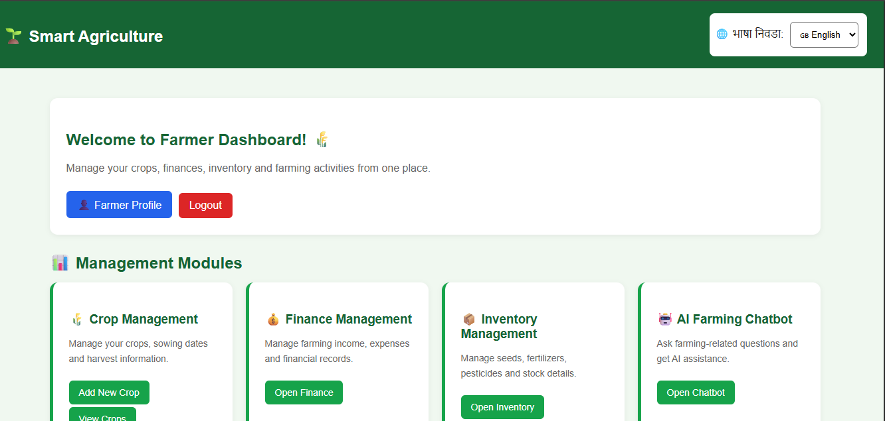
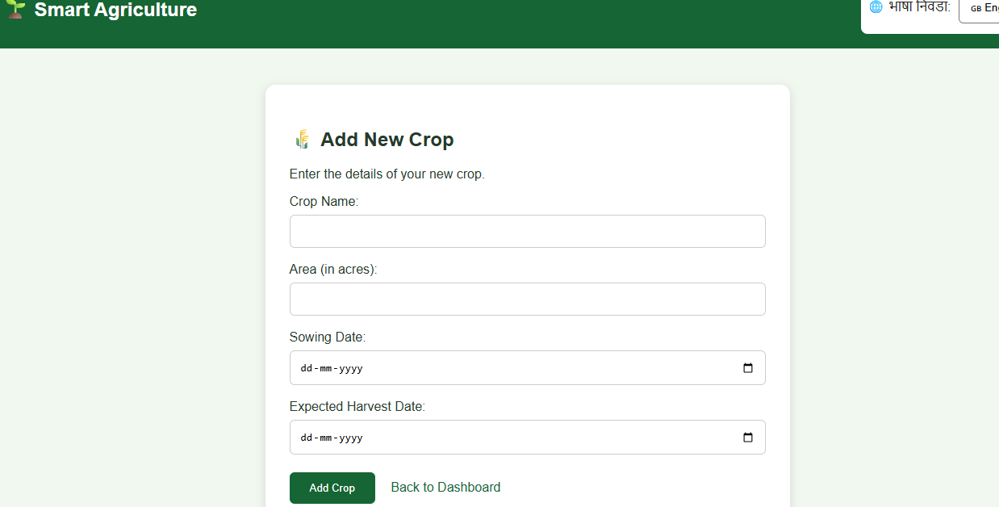
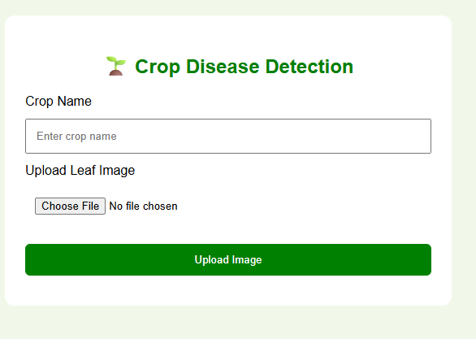
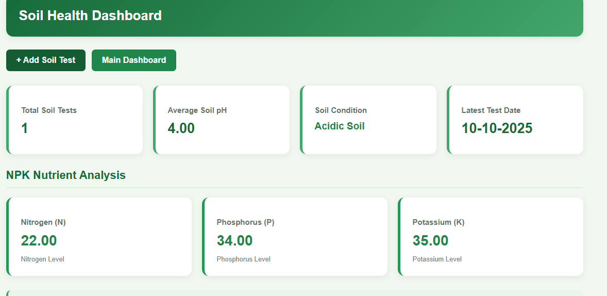
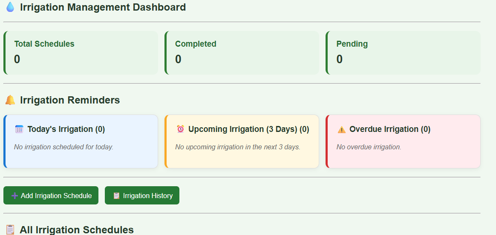
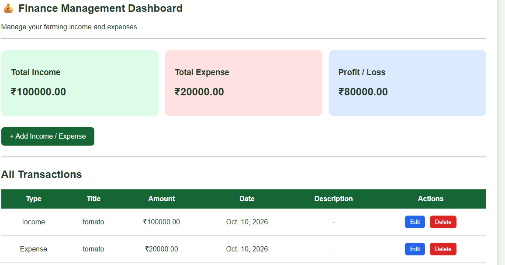
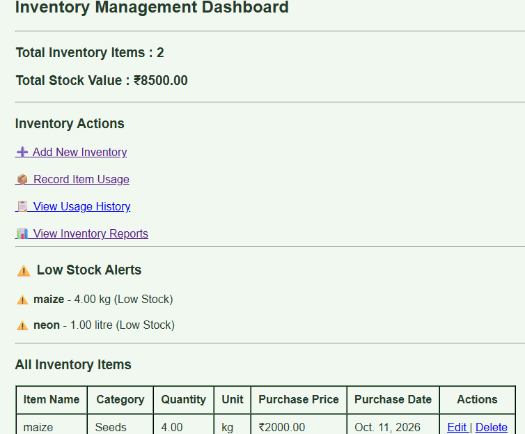
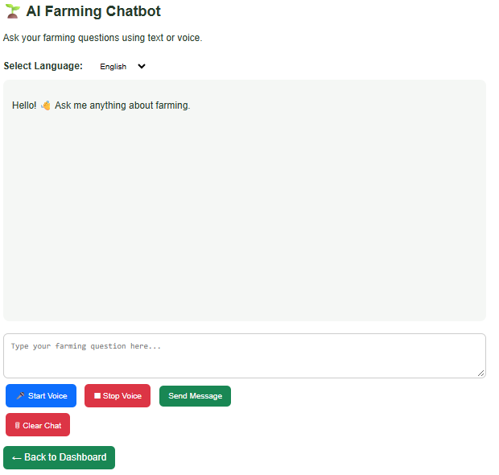

# 🌱 Smart Agriculture Management System

A web-based Smart Agriculture Management System developed using Python and Django to help farmers manage agricultural activities efficiently with AI-powered features.

## 🚀 Key Features

1. User Registration and Login
2. User Profile Management
3. Crop Management
4. AI-Based Plant Disease Detection
5. Irrigation Scheduling
6. Soil Test Management
7. Crop Recommendation
8. Weather Information
9. Inventory Management
10. Finance Management
11. AI Agriculture Assistant
12. Multilingual Support (English and Marathi)

## 🛠️ Technologies Used

- Python
- Django Framework
- HTML5
- CSS3
- JavaScript
- Bootstrap
- SQLite Database
- Google Gemini API

## 📁 Project Modules

- **Accounts:** User authentication and profile management.
- **Farm:** Crop, soil, irrigation and disease management.
- **AI Assistant:** AI-based agriculture assistance and disease analysis.
- **Finance:** Income and expense management.
- **Inventory:** Agricultural inventory and usage tracking.

## ⚙️ Installation

### 1. Clone Repository

```bash
git clone https://github.com/ganeshghayal86-ai/Smart-Agriculture-Management-System.git
```

### 2. Open Project Folder

```bash
cd Smart-Agriculture-Management-System
```

### 3. Create Virtual Environment

```bash
python -m venv venv
```

### 4. Activate Environment

```bash
venv\Scripts\activate
```

### 5. Install Requirements

```bash
pip install -r requirements.txt
```

### 6. Configure Environment Variables

Create a `.env` file and configure the required Django and Gemini API credentials.

Never upload your actual API keys
## Project Screenshots

### 1. Home Page


### 2. Login Page


### 3. Crop Management


### 4. AI Disease Detection


### 5. Soil Health Management


### 6. Irrigation Management


### 7. Finance Management


### 8. Inventory Management


### 9. AI Assistant
